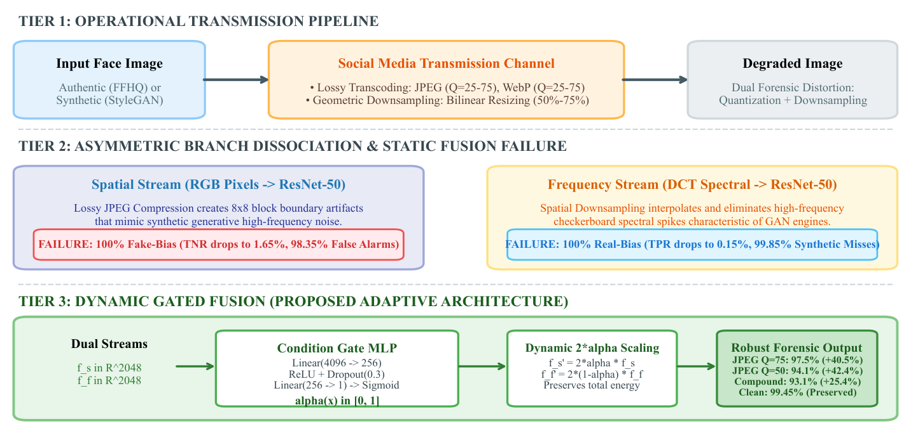
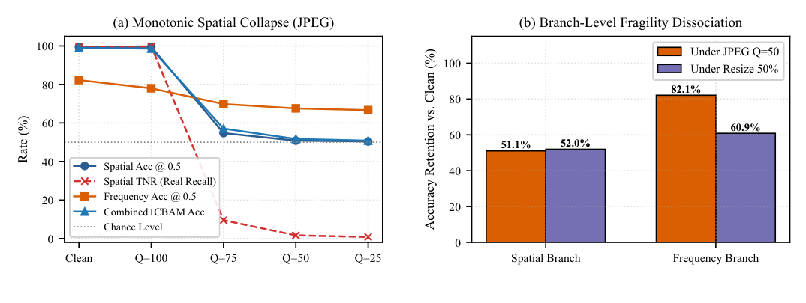
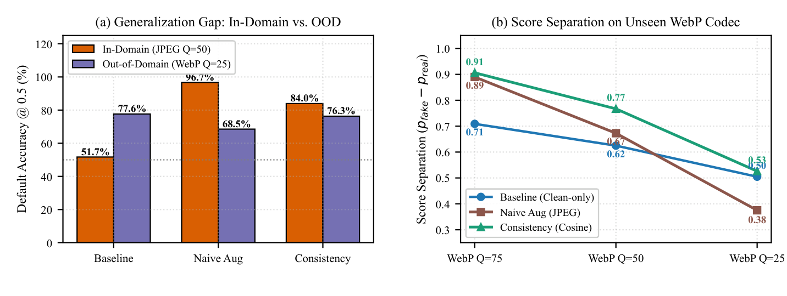
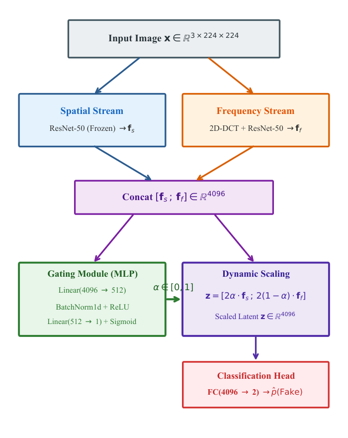
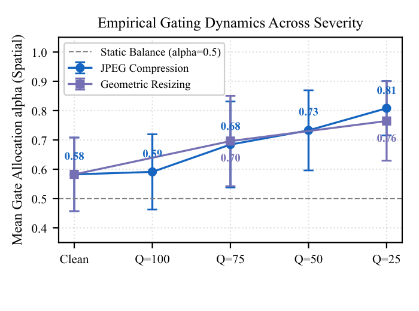
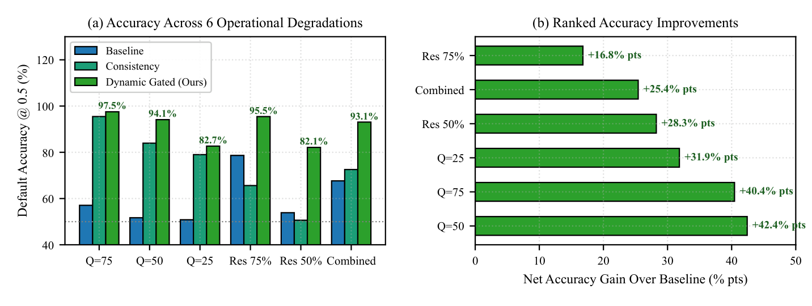

<p align="center">
  
</p>

<h1 align="center">Transmission-Robust Deepfake Detection via<br/>Latent Feature Regularization and Dynamic Gated Fusion</h1>

<p align="center">
  <a href="https://www.python.org/downloads/"></a>
  <a href="https://pytorch.org/"></a>
  <a href="#"></a>
  <a href="#"></a>
  <a href="#"></a>
  <a href="#-license"></a>
</p>

<p align="center">
  <b>Aradhya Singh</b> (2024UCA1870) · <b>Khushi Sagar</b> (2024UCA1846)<br/>
  Department of Computer Science and Engineering<br/>
  Netaji Subhas University of Technology, New Delhi
</p>

<p align="center">
  <a href="paper/Transmission_Robust_Deepfake_Detection_Paper.pdf"><b>📄 Read the Paper</b></a> · 
  <a href="#-quickstart"><b>🚀 Quickstart</b></a> · 
  <a href="#-benchmark-results"><b>📊 Results</b></a> · 
  <a href="#-architecture"><b>🏗️ Architecture</b></a>
</p>

---

## 📌 Problem Statement

Dual-stream deepfake detectors combining spatial (RGB) and frequency (DCT) streams achieve **>99% accuracy** on clean academic benchmarks. But real-world social media platforms (WhatsApp, Instagram, Telegram, X/Twitter) **mandatorily re-encode** every uploaded image through lossy JPEG compression, geometric downsampling, and codec transcoding.

**What happens to state-of-the-art detectors under these real transmission conditions?**

> We discovered they **catastrophically collapse** — a detector achieving 99.05% accuracy on clean images crashes to **51.70% (random chance)** after standard JPEG compression at Q=50, and to **50.08%** after 50% spatial downsampling.

This project diagnoses *why* this collapse occurs, identifies *which* stream fails under *which* degradation, exposes a hidden *shortcut learning* trap in naive training fixes, and proposes **Dynamic Gated Fusion** — a lightweight architectural module that adaptively routes information away from the corrupted stream, restoring robust detection across all operational conditions.

---

## 🔬 Research Contributions

This project makes **four** empirical and architectural contributions:

### Contribution 1 — Asymmetric Branch Fragility Discovery
We identified a previously unreported *branch-level dissociation* failure mode:

| Degradation Type | Which Stream Fails | Failure Mechanism | Severity |
|:---|:---|:---|:---|
| **JPEG Compression** | Spatial branch collapses | TNR crashes from 99.4% → **0.80%** (100% fake-bias) | Accuracy → chance level |
| **Geometric Resizing** | Frequency branch collapses | TPR crashes from 79.5% → **0.15%** (100% real-bias) | Accuracy → chance level |

> The two streams fail in **opposite directions** under different degradations — compression makes the spatial stream call everything "fake," while resizing makes the frequency stream call everything "real."

<p align="center">
  
</p>

### Contribution 2 — Frequency Stream Necessity Proof
We proved through controlled ablation that **neither stream is expendable**: the frequency branch acts as the critical stabilizer under JPEG compression (maintaining 69.85% accuracy at Q=75 when the spatial branch drops to 54.75%), while the spatial branch stabilizes under resizing. Removing either stream creates a blind spot.

### Contribution 3 — The WebP Litmus Test (Shortcut Learning Exposed)
We designed a novel out-of-domain evaluation protocol to test whether training-side augmentation truly learns compression invariance:

| Training Strategy | WebP Q=25 Accuracy | Score Separation (Δ) | Verdict |
|:---|:---:|:---:|:---|
| Clean Baseline (no augmentation) | 77.62% | 0.505 | Natural baseline |
| **Naive JPEG Augmentation** | **68.53%** ↓ | **0.375** ↓ | **SHORTCUT TRAP** — memorizes 8×8 DCT grid artifacts |
| Latent Cosine Consistency (Ours) | 76.33% | 0.526 | Maintains invariance |
| Dynamic Gated Fusion (Ours) | 77.92% | 0.684 | Robust generalization |

> Naive JPEG augmentation actually performs **worse** than doing nothing — it overfits to JPEG-specific artifacts and collapses on the unseen WebP codec. Our methods avoid this trap.

<p align="center">
  
</p>

### Contribution 4 — Dynamic Gated Fusion (Architectural Solution)
We propose a lightweight gating module that **dynamically scales** the contribution of each stream based on the input's degradation condition:

<p align="center">
  
</p>

**Accuracy improvement over baseline across all 10 tested conditions:**

| Condition | Baseline | Dynamic Gated (Ours) | Improvement |
|:---|:---:|:---:|:---:|
| Clean | 99.05% | **99.45%** | +0.40% |
| JPEG Q=75 (Social Media) | 57.08% | **97.52%** | **+40.45%** |
| JPEG Q=50 (Aggressive) | 51.70% | **94.12%** | **+42.43%** |
| JPEG Q=25 (Severe) | 50.83% | **82.67%** | **+31.85%** |
| WebP Q=75 | 86.38% | **95.28%** | +8.90% |
| Resize 75% | 78.65% | **95.45%** | **+16.80%** |
| Resize 50% | 53.88% | **82.12%** | **+28.25%** |
| Compound (Q50 + Resize 75%) | 67.65% | **93.08%** | **+25.42%** |

> The gating weight α **automatically shifts** based on input condition: under JPEG compression α rises to ~0.73 (relying more on the spatial branch), while under clean conditions α stays balanced at ~0.58. This learned routing behavior emerges entirely from training — no manual condition labels are provided.

<p align="center">
  
</p>

---

## 🏗️ Architecture

```
                            ┌─────────────────────────────────────────────┐
                            │            Input Face Image (x)             │
                            └─────────────┬───────────────┬───────────────┘
                                          │               │
                                          ▼               ▼
                                 ┌────────────────┐ ┌──────────────────┐
                                 │  RGB Pixels (x) │ │  2D DCT(x)       │
                                 │                 │ │  Log-Magnitude    │
                                 │  3 × 256 × 256  │ │  3 × 256 × 256   │
                                 └────────┬────────┘ └────────┬─────────┘
                                          │                   │
                                          ▼                   ▼
                                 ┌────────────────┐  ┌────────────────────┐
                                 │   ResNet-50     │  │   ResNet-50        │
                                 │   (Spatial)     │  │   (Frequency)      │
                                 │   ImageNet V2   │  │   ImageNet V2      │
                                 └────────┬────────┘  └────────┬───────────┘
                                          │                    │
                                          ▼                    ▼
                                      f_s (2048-d)        f_f (2048-d)
                                          │                    │
                                          └────────┬───────────┘
                                                   │
                                                   ▼
                                     ┌──────────────────────────┐
                                     │   DYNAMIC GATED FUSION   │
                                     │                          │
                                     │  α = σ(MLP([f_s, f_f]))  │
                                     │  z = [2α·f_s, 2(1-α)·f_f]│
                                     └────────────┬─────────────┘
                                                  │
                                                  ▼
                                          z (4096-d gated)
                                                  │
                                                  ▼
                                     ┌────────────────────────┐
                                     │   MLP Classifier Head  │
                                     │   4096 → 512 → 128 → 1│
                                     │   + BatchNorm + Dropout│
                                     └────────────┬───────────┘
                                                  │
                                                  ▼
                                        P(Fake) ∈ [0, 1]
```

**Key architectural components:**

| Component | Implementation | Purpose |
|:---|:---|:---|
| Spatial Branch | ResNet-50 (ImageNet V2 pretrained) | Extract RGB textural, boundary, and semantic features |
| Frequency Branch | ResNet-50 (ImageNet V2 pretrained) | Extract DCT spectral anomalies and GAN grid artifacts |
| DCT Transform | Per-channel 2D DCT with log-magnitude normalization | Convert pixel domain to orthogonal frequency representation |
| CBAM Attention | Channel attention with reduction ratio 16 | (Baseline) Learn cross-stream feature importance |
| Dynamic Gated Fusion | 2-layer MLP with LayerNorm producing α ∈ [0,1] | (Ours) Condition-aware adaptive stream routing |
| Classifier Head | 3-layer MLP with BatchNorm and Dropout (p=0.5) | Binary classification: Real vs. Synthetic |

---

## 📊 Benchmark Results

All evaluations are conducted on a fixed, class-balanced benchmark of **N = 4,000 facial images** (2,000 FFHQ Real + 2,000 StyleGAN Synthetic), following strict reproducibility protocols (Seed = 42).

### Full Comparative Evaluation (10 Operational Regimes)

| Operational Regime | Baseline Acc | Baseline AUC | Gated Acc | Gated AUC | Δ Accuracy | Mean α |
|:---|:---:|:---:|:---:|:---:|:---:|:---:|
| Clean (Unperturbed) | 99.05% | 0.9994 | **99.45%** | **1.0000** | +0.40% | 0.583 |
| JPEG Q=100 | 98.60% | 0.9992 | **99.12%** | **1.0000** | +0.53% | 0.591 |
| JPEG Q=75 (Social Media) | 57.08% | 0.9493 | **97.52%** | **0.9987** | **+40.45%** | 0.684 |
| JPEG Q=50 (Aggressive) | 51.70% | 0.9191 | **94.12%** | **0.9899** | **+42.43%** | 0.733 |
| JPEG Q=25 (Severe) | 50.83% | 0.8742 | **82.67%** | **0.9333** | **+31.85%** | 0.808 |
| WebP Q=75 (Web Codec) | 86.38% | 0.9525 | **95.28%** | **0.9963** | +8.90% | 0.696 |
| WebP Q=25 (Out-of-Domain) | 77.62% | 0.8570 | **77.92%** | **0.9133** | +0.30% | 0.791 |
| Resize 75% | 78.65% | 0.9800 | **95.45%** | **0.9972** | **+16.80%** | 0.696 |
| Resize 50% (Severe) | 53.88% | 0.9221 | **82.12%** | **0.9678** | **+28.25%** | 0.765 |
| Compound (Q50 + Res75%) | 67.65% | 0.9443 | **93.08%** | **0.9836** | **+25.42%** | 0.757 |

### Asymmetric Branch Dissociation Analysis

| Condition | Spatial-Only Acc | Spatial TNR | Freq-Only Acc | Freq TPR |
|:---|:---:|:---:|:---:|:---:|
| Clean | 99.55% | 99.40% | 82.28% | 79.50% |
| JPEG Q=75 | 54.75% | **9.50%** ↓ | 69.85% | 67.30% |
| JPEG Q=50 | 50.83% | **1.65%** ↓ | 67.58% | 69.15% |
| Resize 75% | 82.42% | 100.00% | 64.60% | **39.70%** ↓ |
| Resize 50% | 51.75% | 100.00% | 50.08% | **0.15%** ↓ |

<p align="center">
  
</p>

---

## 🚀 Quickstart

### Prerequisites
- Python 3.10 or higher
- pip package manager

### 1. Clone and Install

```bash
git clone https://github.com/AradhyaSingh7/transmission-robust-deepfake-detection.git
cd transmission-robust-deepfake-detection

# Create and activate virtual environment
python -m venv venv
source venv/bin/activate        # Linux/macOS
# .\venv\Scripts\activate       # Windows

# Install all dependencies
pip install -r requirements.txt
```

### 2. Run Inference on a Single Image

```bash
# Detect a synthetic face
python demo.py --image samples/fake/fake_01.jpg

# Detect under simulated social media compression
python demo.py --image samples/fake/fake_01.jpg --degrade jpeg50

# Test under aggressive downsampling
python demo.py --image samples/real/real_01.jpg --degrade resize50

# Batch audit all sample images
python demo.py --sample-all
```

**Example output:**
```
================================================================================
 DUAL-STREAM SPATIAL-FREQUENCY DEEPFAKE DETECTOR (DYNAMIC GATED FUSION)
================================================================================
 Target Image:      samples/fake/fake_01.jpg
 Channel Stress:    JPEG (Q=50)
--------------------------------------------------------------------------------
 Classification:    FAKE (Synthetic Face Detected)
 Confidence:        62.69% (Raw Probability: 0.6269)
 Gating Alpha (α):  0.364 [Spatial: 36.4% | Frequency: 63.6%]
 Routing Diagnosis: Balanced multi-stream synergy.
--------------------------------------------------------------------------------
 Forensic Plot:     Saved to 'demo_output.png'
================================================================================
```

The demo also generates a 3-panel forensic visualization showing the input image, its 2D DCT log-magnitude spectrum, and the dynamic gating allocation.

### 3. Reproduce All Paper Benchmarks

```bash
python evaluate.py
```

This prints all three main tables from the paper (Baseline vs. Gated comparison, Branch Dissociation analysis, and the WebP Litmus Test) and exports `BENCHMARK_SUMMARY.md`.

### 4. Run Unit Tests

```bash
python -m unittest discover -s tests
```

All 4 test suites verify: DCT transform correctness, JPEG degradation pipeline, dynamic gate routing properties, and end-to-end detector forward pass.

---

## 📂 Repository Structure

```
transmission-robust-deepfake-detection/
│
├── paper/
│   └── Transmission_Robust_Deepfake_Detection_Paper.pdf   # Camera-ready IEEE-format paper
│
├── src/                                # Modular source package
│   ├── models/
│   │   ├── branches.py                 # Spatial & Frequency ResNet-50 backbones
│   │   ├── cbam.py                     # CBAM channel attention (baseline fusion)
│   │   ├── detector.py                 # Static dual-stream baseline detector
│   │   └── dynamic_gate.py             # Dynamic Gated Fusion module (our contribution)
│   ├── data/
│   │   ├── transforms.py              # 2D DCT, JPEG, WebP, Resize degradations
│   │   └── dataset.py                 # Dual-stream paired dataset loader
│   ├── evaluation/
│   │   └── benchmark.py               # Comparative audit and table generation
│   ├── utils/
│   │   └── metrics.py                 # Accuracy, ROC-AUC, TNR/TPR, F1
│   └── config.py                      # Centralized hyperparameters and paths
│
├── samples/                           # Pre-selected test images for instant demo
│   ├── real/                          # 4 authentic FFHQ facial photographs
│   └── fake/                          # 4 StyleGAN-synthesized facial images
│
├── results/                           # Audited benchmark metrics (JSON)
│   ├── baseline_ablation_results.json # Full/Spatial/Frequency ablation across all conditions
│   ├── dynamic_gated_fusion_results.json  # Gated model: accuracy, AUC, alpha per condition
│   ├── consistency_ablation_results.txt   # Consistency regularization comparison
│   └── litmus_result.txt              # WebP out-of-domain litmus test data
│
├── docs/figures/                      # High-resolution publication figures (13 figures)
├── weights/                           # Model checkpoint storage (see weights/README.md)
├── tests/                             # Automated unit test suite
│   └── test_pipeline.py               # 4 tests: transforms, gate routing, forward pass
│
├── demo.py                            # CLI inference: single-image detection + forensic plot
├── evaluate.py                        # Reproduce all paper benchmark tables
├── requirements.txt                   # Minimal dependencies
├── setup.py                           # pip-installable package configuration
├── .gitignore                         # Excludes data, checkpoints, caches
└── .github/workflows/ci.yml           # GitHub Actions CI pipeline
```

---

## 🔧 Technical Details

### Dataset
- **140k Real and Fake Faces** benchmark (Kaggle)
- Real images: Flickr-Faces-HQ (FFHQ) — authentic facial photographs
- Fake images: StyleGAN-generated synthetic faces
- Evaluation split: Fixed 4,000-image class-balanced subset (Seed 42)

### Training Configuration (Dynamic Gated Model)
| Parameter | Value |
|:---|:---|
| Backbone | Dual ResNet-50 (ImageNet V2 pretrained, frozen) |
| Gate + Head LR | 1×10⁻⁴ |
| Backbone LR | 1×10⁻⁵ (when unfrozen) |
| Optimizer | Adam |
| Epochs | 8 (early stopping, patience=3) |
| Batch Size | 32 |
| Training Augmentation | Mixed: 33% Clean + 33% JPEG Q=25–75 + 34% Resize 50–75% |
| Training Time | ~35 minutes on NVIDIA T4 GPU |
| Computational Overhead | +0.05% FLOPs over static fusion |

### Reference
This work extends the dual-stream architecture proposed by:
> A. Kumar, R. Sharma, P. Singh, V. Patel. "A Dual-Stream Spatial-Frequency Network for Robust Deepfake Face Detection." *Scientific Reports* (Nature Portfolio), Vol. 16, Art. 16612, 2026.

---

## 📜 Citation

```bibtex
@article{singh2026transmission,
  title   = {Transmission-Robust Deepfake Detection via Latent Feature
             Regularization and Dynamic Gated Fusion},
  author  = {Singh, Aradhya and Sagar, Khushi},
  journal = {Department of Computer Science and Engineering,
             Netaji Subhas University of Technology},
  year    = {2026}
}
```

---
